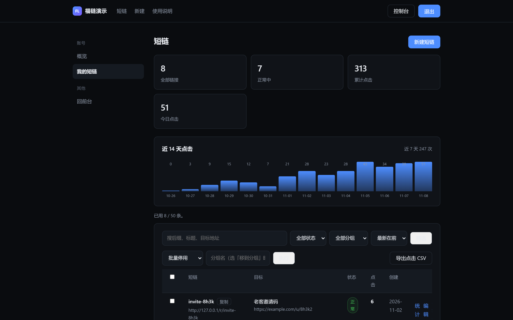
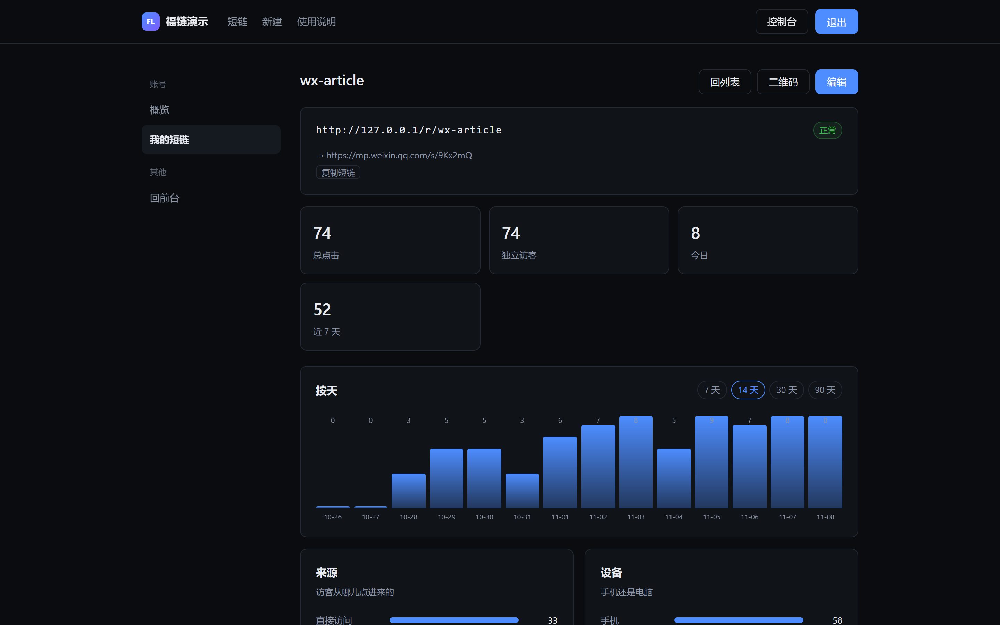
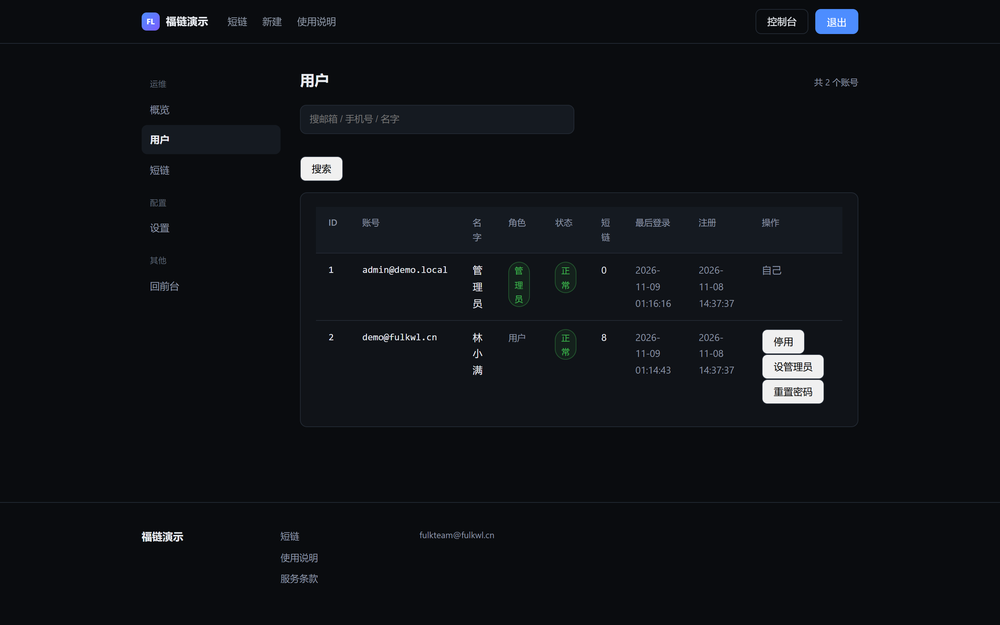
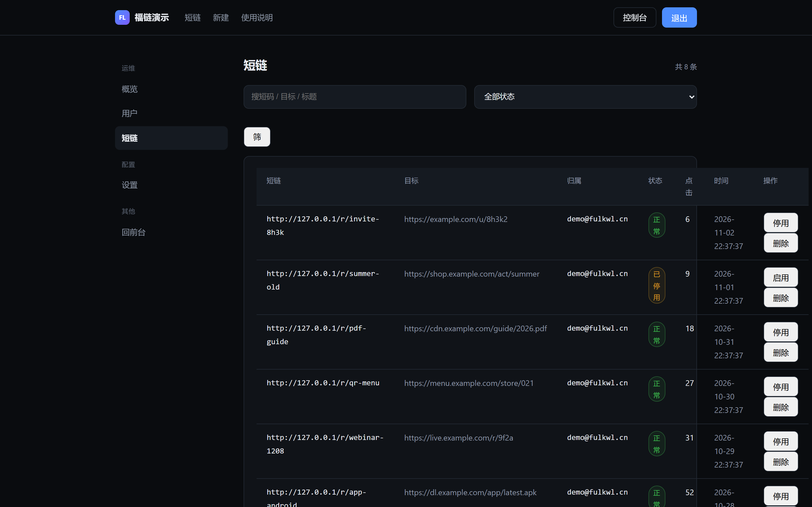

# FulkLink 福链 · 开源版

自己部署的短链系统。PHP + MySQL，零依赖——没有 Composer，没有 Node，没有 Redis，没有队列，没有定时任务。

上传、装库、改 `.env`，五分钟能跑起来。

> 一个短链系统该有的东西：短链、二维码、点击记录、有效期、访问上限、链接密码、分组、批量操作、CSV 导出。
> 一个短链系统不该有的东西：把你的访客 IP 明文存进数据库。

English: FulkLink is a self-hosted URL shortener written in plain PHP 8 + MySQL 5.7+, with zero dependencies. Features short links, QR codes, click analytics, password-protected links, expiry, click caps, groups and CSV export. Click IPs are stored as salted hashes only. Licensed under AGPL-3.0.

| 短链列表 | 点击统计 |
|---|---|
|  |  |
| **管理后台 · 用户** | **管理后台 · 短链** |
|  |  |

---

## 为什么又造一个短链系统

市面上的选择大概三类，每类都有个明显的坑：

- **SaaS 短链**（bit.ly 这类）：链接在别人域名下，你的数据在别人库里，免费额度一到就开始收费，出了政策变动你连申诉对象都找不到。
- **大而全的开源面板**：装完发现要 Composer、要队列、要 Redis、要 cron 守护进程，一个小功能带进来二十个依赖，服务器从 1 核变 4 核。
- **网上买的源码**：能用，但加密的、绑域名的、留后门的、作者跑路的，都在这条路上。

这个项目就是为这三种情况写的。核心逻辑不到 1 万行 PHP，装完就是一个文件夹加一个数据库，随时能迁走。

## 功能

**短链**

- 自定义短码，格式和保留词都有校验；不填则随机生成 6 位
- 目标地址校验，可配置目标域名白名单
- 有效期（到点自动失效）
- 访问次数上限（到量自动停）
- 链接密码（访问前需输入，错误次数有限流）
- 分组管理
- 批量启用 / 停用 / 删除 / 改分组
- CSV 导出
- 单条链接的二维码，本地生成，不走第三方接口

**点击记录**

每次跳转记一条，字段是：时间、IP 哈希、User-Agent、Referer、来源渠道、设备类型（桌面/手机/平板/爬虫）、操作系统、浏览器。

统计视图给的是：近 14 天趋势、来源 Top、设备分布、浏览器分布、系统分布、最近访问明细。

**账号与后台**

- 注册 / 登录 / 邮件验证码 / 改密 / 忘记密码自助重置
- 多用户，数据互相隔离
- 管理后台：用户管理（搜索、停用 / 启用、设管理员、重置密码）、全站短链管理（搜索、停用 / 启用 / 删除）、站点设置、SMTP 测试、操作日志

**部署**

- Web 安装向导，逐项体检（PHP 版本、扩展、目录权限、MySQL 版本）再装库
- 装完自动生成 `.env`，含随机 `APP_KEY`
- 不需要 cron、不需要常驻进程、不需要 Node

## 开源版不包含什么

这部分写清楚，免得你装完发现少东西：

| 功能 | 状态 |
|---|---|
| 自定义域名（绑自己的域名做短链） | 商业版 |
| 团队协作与成员权限 | 商业版 |
| 开放 API / API Key | 商业版 |
| 地区统计（IP 归属地） | 商业版（需要归属地库） |
| 云端风控、恶意链接拦截、跳转前置提醒 | 商业版 |
| 商业授权码与加密交付 | 商业版 |

开源版拿到的是一套完整可用的短链系统，不是试用版、不是功能阉割到不能用的演示版。上面这些是给商业客户准备的运维能力。

## 环境要求

- PHP **8.0+**（8.1 / 8.2 都测过）
- MySQL **5.7+** / MariaDB 10.3+，utf8mb4
- 扩展：`pdo` `pdo_mysql` `mbstring` `openssl` `curl` `json` `session`
- Nginx 或 Apache，需要 URL 重写（伪静态）

不需要 Composer，不需要 Node，不需要 Redis。

## 安装

### 方式一：安装向导（推荐）

1. 把代码传到站点目录，网站根目录指向 `public/`
2. 浏览器打开 `https://你的域名/install.php`
3. 按向导填数据库信息、管理员账号
4. 装完删掉 `install/` 目录和 `public/install.php`

向导会先做体检，缺什么扩展、哪个目录不可写，都会直接告诉你。

### 方式二：手动

```bash
# 1. 导入表结构
mysql -u root -p 你的库名 < database/schema.sql

# 2. 复制配置
cp .env.example .env
# 编辑 .env：SITE_URL、DB_*、APP_KEY（随便一段 32 位以上随机串）

# 3. 权限
chown -R www:www data
chmod -R 755 data
```

### Nginx 伪静态

```nginx
root /www/wwwroot/你的站点/public;

location / {
    try_files $uri $uri/ /index.php?$query_string;
}

location ~ \.php$ {
    fastcgi_pass unix:/tmp/php-cgi-82.sock;
    fastcgi_index index.php;
    include fastcgi.conf;
}
```

Apache 用户：`public/.htaccess` 已经写好，确认 `AllowOverride All` 开着即可。

### 装完检查

访问 `/health`，返回 JSON 且 `"status": "ok"`、`"db": "ok"` 就说明数据库和配置都通了，`version` 显示当前程序版本。

## 云端更新（1.0.3 起）

入口：管理员登录后打开 `/admin/update`。

- **1.0.3 → 1.0.4 需手工升级**：1.0.4 修改了 `app/Migrator.php`，而迁移器比对运行在客户端本地，1.0.3 站点在线安装 1.0.4 会被拒绝（这是设计行为，防在线篡改数据库迁移）。请按下面「首次升级」同样的手工步骤覆盖程序文件；数据库无需迁移。默认更新源仍指向 1.0.3，不会误推送本版。

- **首次升级**：1.0.2 及更早版本没有接收入口。先备份文件和数据库，再把本包的 `app/`、`public/index.php`、`config/config.php`、`VERSION`、`MANIFEST.json` 同步到站点，保留 `.env` 和 `data/`，不要重新导入数据库，不要恢复已经删除的安装器。
- **主动更新**：配置可信 HTTPS 更新清单 → 检查更新 → 下载并安装。默认开源更新源为 `https://lp.fulkteam.cn/update.json`，现已上线；清单不可达会明确显示获取失败。留空保存可关闭拉取，不会恢复默认值。
- **直接推包**：本站管理员生成独立推送密钥、勾选授权，并将密钥安全交给可信发布者。发布者可在云端后台上传 ZIP，或运行发版侧推送工具，客户端验签后直接安装。密钥只展示一次，遗失时重新生成。客户端不携带发布者运维工具。
- **备份回滚**：程序覆盖前生成经过校验的备份；写入失败尝试恢复。异常中断时一般请求返回 503，管理员可进入更新页回滚；若程序入口本身不可运行，则由运维从 `data/updates/backups/` 人工恢复。文件回滚不包含数据库回滚。
- **范围**：只接受更高版本、相同发行类型的完整官方构建包。数据库迁移代码或定义变动时拒绝在线更新，需要人工迁移。`.env`、`data/`、客户身份和安装器均不被在线覆盖。

更新功能额外要求 PHP `zip` 扩展，程序目录和 `data/updates/` 可写。客户端接收 JSON 最大 12 MiB，ZIP 最大 8 MiB；请相应配置 Nginx `client_max_body_size`、PHP `post_max_size`，云端上传页面另需 `upload_max_filesize`。发包超时不能盲目重发，先检查客户端 `/health` 与后台状态。

## 目录结构

```
app/
  Controllers/     请求处理，一个页面一个方法
  Views/           模板，纯 PHP，没有模板引擎
  Cloud/           能力开关与云端接口（开源版是桩）
  Shorten.php      短码生成、校验、增删改查
  LinkStats.php    点击记录与统计聚合
  Auth.php         注册登录、密码哈希、会话
  Migrator.php     表结构版本迁移
  routes.php       路由表
config/config.php  所有配置项，读环境变量
database/schema.sql 建表语句
install/           Web 安装向导
public/            唯一的对外目录
  index.php        入口
  router.php       PHP 内置服务器路由（本地调试用）
  assets/          CSS 和二维码库（本地，无 CDN）
data/              运行期数据：日志、锁、缓存（不对外）
```

## 几个配置项

`.env` 里改动最频繁的几个：

```ini
SITE_NAME="我的短链"
SITE_URL="https://s.example.com"   # 必须带协议，不带结尾斜杠
APP_KEY=                            # 安装向导生成，换机器要一起搬走
COOKIE_SECURE=true                  # 还在用 http 调试就先改成 false
SHORT_DOMAIN=""                     # 留空不限制目标域名，一行一个
```

`SHORT_DOMAIN` 值得单独说：填了之后，只有这些域名能被缩短。如果你的站对外提供服务，建议填上，否则会被人拿来生成指向任意站点的短链（钓鱼短链最常见的就是这么来的）。

## 关于隐私

`clicks` 表里没有明文 IP。每条记录存的是 `md5(ip + APP_KEY)` 的前 32 位，用于「同一个人点了多少次」这类统计，没法和真实 IP 反查。

这是有意的设计：一份公开可访问的短链系统，数据库里堆着几十万条访客真实 IP，是个随时会爆的合规风险。

代价是：做不到「按 IP 精确定位某个访客」，也做不到独立访客去重（换 IP 就是新访客）。短链统计不需要那么精确。

## 安全设计

- 密码走 `password_hash()`（bcrypt），不存明文、不用 md5
- 全部写操作校验 CSRF token
- 短码格式白名单 + 保留词黑名单，防路径穿越和路由抢占
- 目标地址协议校验，只放行 http / https
- 链接密码错误限流，15 分钟内超过阈值直接锁
- 登录失败计数与冷却
- 所有 SQL 走预处理，不拼字符串
- 模板输出统一转义

发现安全问题请发邮件，别开公开 issue。

## 协议

**AGPL-3.0**。完整条款见 [LICENSE](LICENSE)。

说人话：

- 自己用、公司内部用、改着玩、二次开发，都可以，不用问
- 改了之后对外提供网络服务，需要把你的修改也开源
- 想基于它做闭源商业产品，需要一份商业授权

## 商业版

[FulkLink 商业版](https://lp.fulkteam.cn) 在开源版基础上多了：自定义域名、团队与权限、开放 API、地区统计、云端风控（恶意链接库、跳转前置提醒）、授权与更新通道、以及交付时的代码加密与订单溯源。

买的是运维能力和省下来的时间，不是买基础功能。

## 联系

- 官网：https://lp.fulkteam.cn
- 邮箱：fulkteam@fulkwl.cn
- 问题反馈：开 issue，附 PHP 版本、MySQL 版本、`data/php-error.log` 相关片段

## 更新记录

见 [CHANGELOG.md](CHANGELOG.md)。
